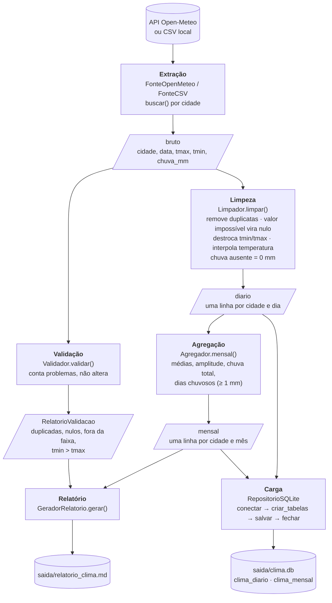
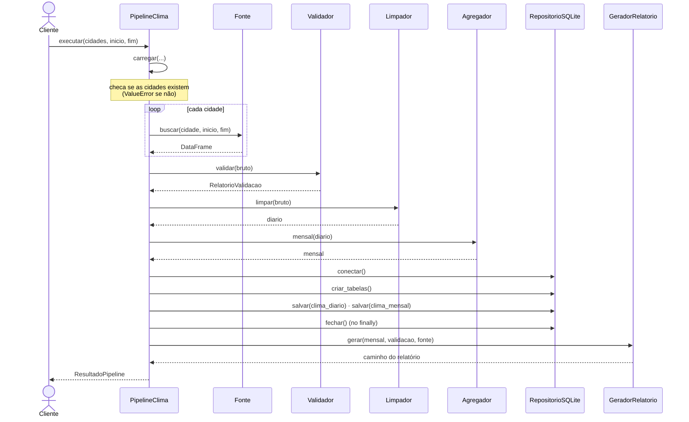
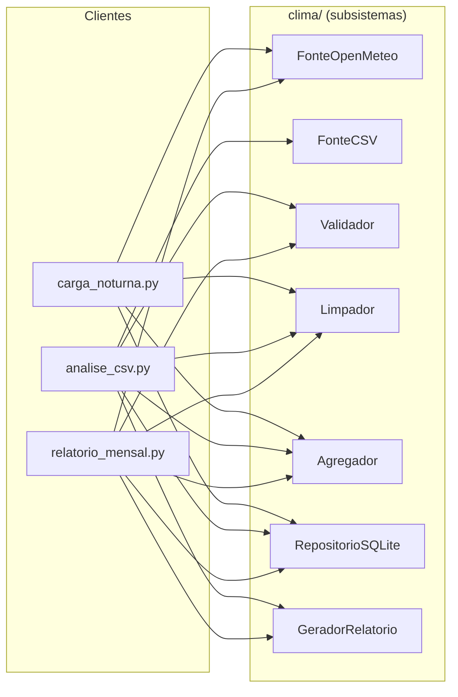
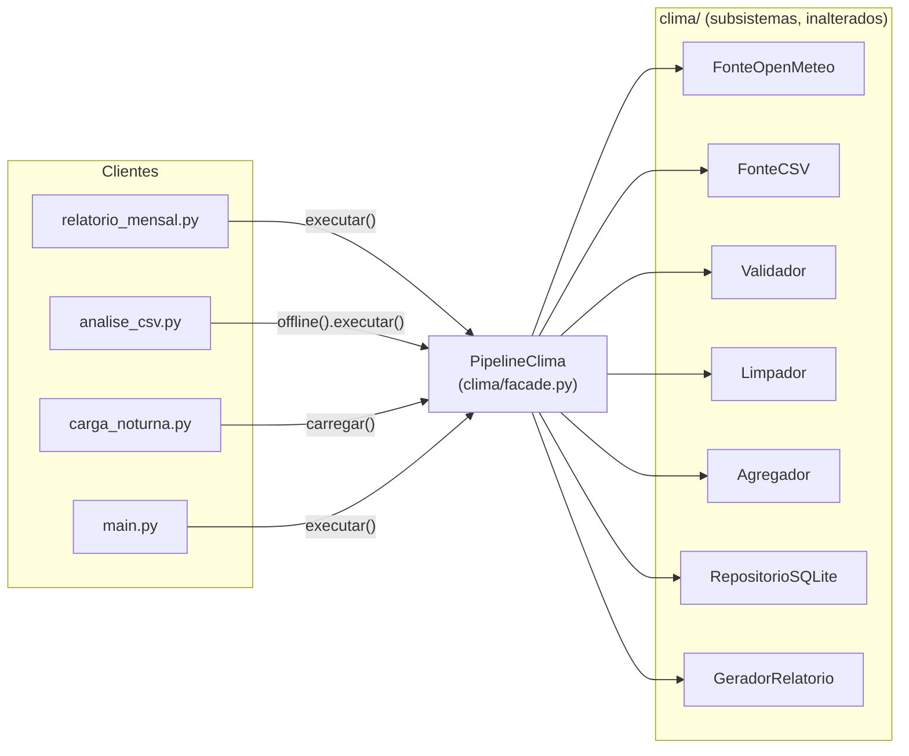

# Pipeline de clima — antes e depois do Facade

Trabalho A2 de Engenharia de Software (FGV EMAp, 2026.2) sobre o padrão **Facade**.
O mesmo pipeline de dados existe em duas versões, com **os mesmos subsistemas**:

| Versão | Pasta | Como os clientes usam o pipeline |
| --- | --- | --- |
| Original | `original/` | Cada cliente importa os subsistemas e monta a sequência na mão |
| Refatorada | `refatorado/` | Cada cliente faz uma chamada à fachada `PipelineClima` |

`diff -r original/clima refatorado/clima` mostra que a única diferença no pacote é o
`facade.py` (e o `__init__.py` que o exporta). O que muda são os clientes.

## O pipeline

Temperatura máxima, mínima e chuva diárias de Rio de Janeiro, São Paulo e Belo Horizonte,
de jan a mar/2026.

### Fluxo dos dados



A validação só mede a qualidade do dado bruto; quem corrige é a limpeza. O relatório
junta duas saídas que vêm de ramos diferentes: o resumo mensal e o resultado da validação.

### Ordem das chamadas (versão refatorada)

O mesmo fluxo, visto a partir de uma chamada do cliente à fachada. `carregar()` para
depois da carga no banco; `executar()` faz tudo isso e ainda gera o relatório.



Na versão original não existe a coluna `PipelineClima`: é o próprio cliente que faz
cada uma dessas chamadas, na ordem.

| Subsistema | Arquivo | Responsabilidade |
| --- | --- | --- |
| `FonteOpenMeteo`, `FonteCSV` | `clima/extracao.py` | Buscar os dados diários (mesma interface: `buscar`) |
| `Validador` | `clima/validacao.py` | Medir a qualidade dos dados brutos sem alterá-los |
| `Limpador` | `clima/limpeza.py` | Tratar duplicatas, valores impossíveis, inversões e lacunas |
| `Agregador` | `clima/agregacao.py` | Resumir por cidade e mês |
| `RepositorioSQLite` | `clima/carga.py` | Gravar no banco (protocolo: `conectar → criar_tabelas → salvar → fechar`) |
| `GeradorRelatorio` | `clima/relatorio.py` | Escrever o relatório em Markdown |

## Arquitetura

**Original:** cada cliente fala direto com os subsistemas que usa, e cada um repete a
ordem das etapas e o protocolo do banco.



**Refatorada:** os clientes só conhecem a fachada `PipelineClima`, que cria os
subsistemas e os chama na ordem certa.



## Os três clientes

As duas versões têm os mesmos clientes, com os mesmos nomes e assinaturas:

| Cliente | Fonte | O que faz |
| --- | --- | --- |
| `relatorio_mensal.py` | API | Pipeline completo, com relatório |
| `analise_csv.py` | CSV local | Pipeline completo e imprime a validação |
| `carga_noturna.py` | API | Só até o banco, sem relatório |

## Estrutura

```
pipeline-clima/
├── original/
│   ├── clima/                  # subsistemas, sem fachada
│   └── relatorio_mensal.py, analise_csv.py, carga_noturna.py
├── refatorado/
│   ├── clima/                  # mesmos subsistemas + facade.py
│   ├── relatorio_mensal.py, analise_csv.py, carga_noturna.py
│   ├── main.py               
│   └── tests/test_pipeline.py  # testes da fachada
├── dados/
│   ├── clima_amostra.csv       # dados reais do Open-Meteo, para rodar offline
│   └── clima_sujo.csv          # a mesma amostra com defeitos injetados
└── tests/test_equivalencia.py  # original × refatorado
```

**Sobre `clima_sujo.csv`:** é a amostra real com defeitos colocados à mão para a
demonstração: 3 nulos, `tmax` = 999 °C em São Paulo (31/01), chuva negativa, `tmin` e
`tmax` trocados num dia e 3 linhas repetidas. Não são dados reais.

## Como rodar

Requer Python 3.10+ (testado em 3.11 e 3.14).

```bash
python -m venv .venv && source .venv/bin/activate
pip install -r requirements.txt

pytest                        # todos os testes, offline

cd original                   # ou: cd refatorado
python analise_csv.py         # offline, com o CSV sujo
python relatorio_mensal.py    # precisa de internet (API Open-Meteo)
python carga_noturna.py       # precisa de internet
```

As saídas (`clima.db`, `relatorio_clima.md`) vão para `saida/` dentro da pasta da versão,
fora do Git.

## Comportamento preservado

`tests/test_equivalencia.py` roda cada cliente nas duas versões com os dois CSVs
(6 casos) e confere que são iguais: o resumo mensal, as tabelas do banco, o relatório
(exceto a data de geração) e o que é impresso na tela. Como as duas versões têm um
pacote `clima`, cada uma roda num processo próprio.

Única diferença intencional: com uma cidade desconhecida, `original/carga_noturna.py`
gera `KeyError`, porque não faz a checagem que os outros dois clientes fazem. Na versão
refatorada, a checagem está na fachada e vale para todos (`ValueError`).

## Mapeamento para o padrão (Refactoring Guru)

| Participante | Neste projeto |
| --- | --- |
| Fachada | `PipelineClima` (`executar`, `carregar`, `offline`) |
| Subsistema complexo | as seis classes de `clima/` |
| Cliente | os três clientes, `main.py`, o notebook e os testes |
| Fachada adicional | ainda não existe; candidata natural: uma `RelatorioFacade` se o relatório ganhar gráficos e PDF |

Os subsistemas não importam a fachada e continuam utilizáveis direto.

## Integrantes

| Nome | Matrícula |
| --- | --- |
| Isaías Gouvêa Gonçalves | `<matrícula>` |
| Henrique Gasparelo | `<matrícula>` |
| Henrique Beltrão | `<matrícula>` |
| Mateus Mourão | `<matrícula>` |
| Thevez | `<matrícula>` |
